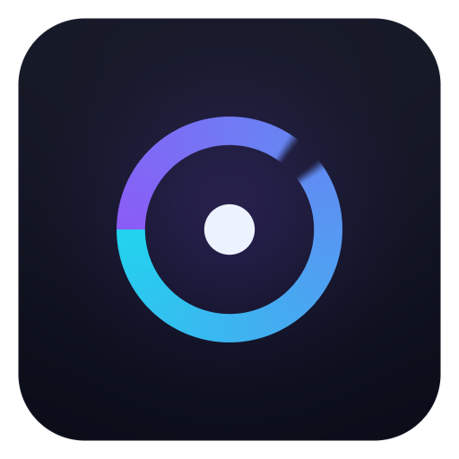
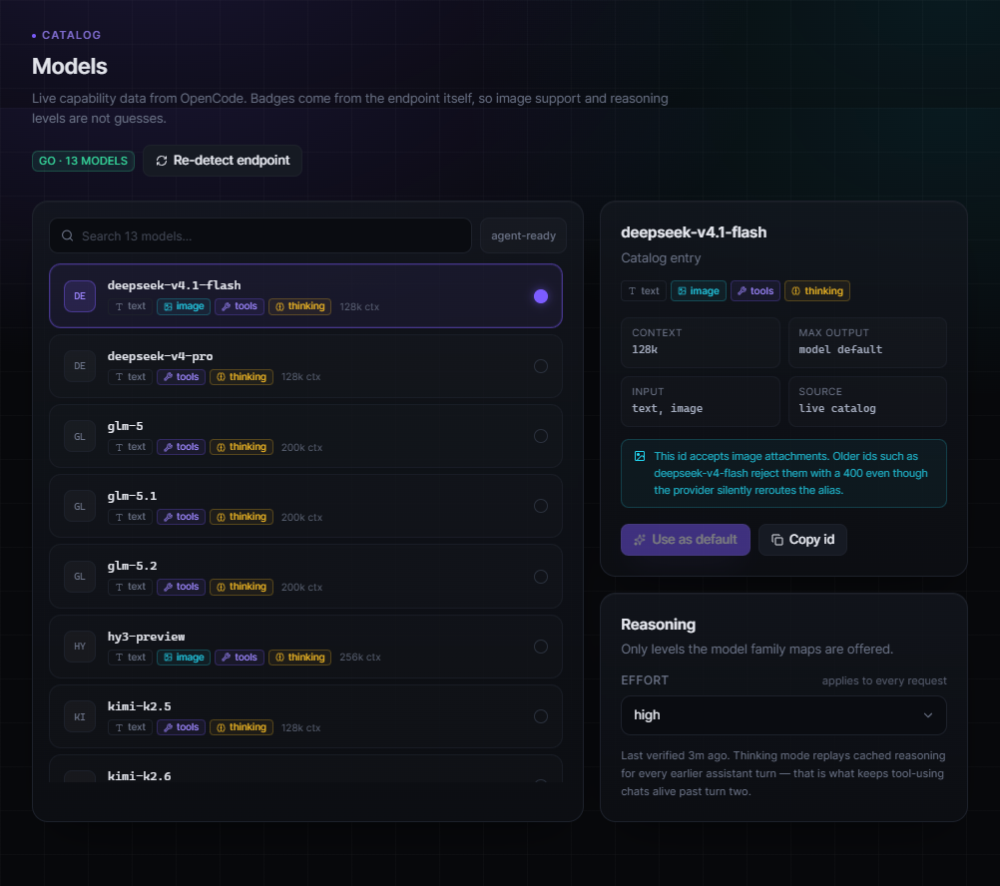
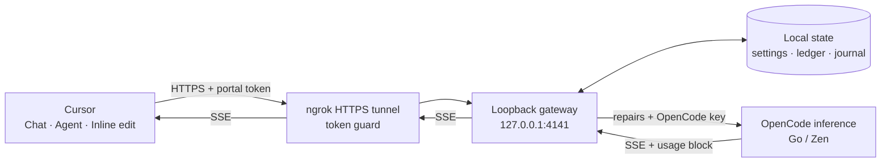
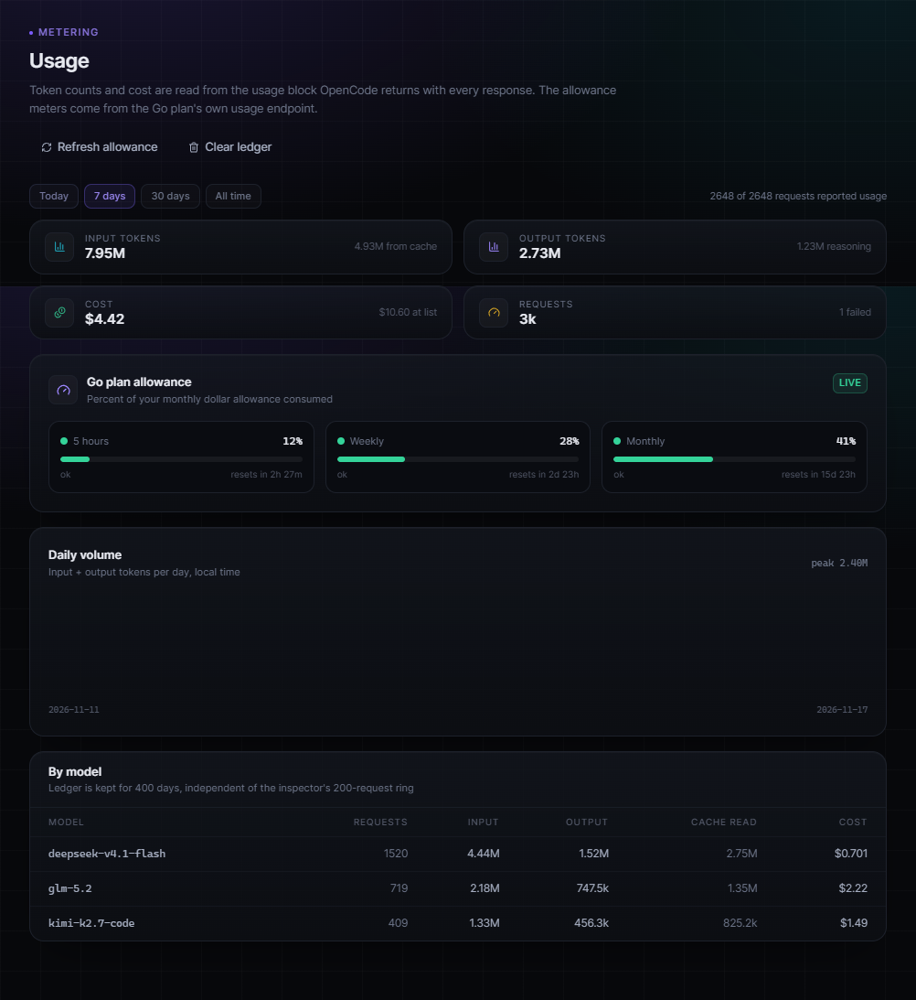

<div align="center">



# OpenCode Portal

**Your OpenCode Go / Zen models, inside Cursor — with a real gateway, not a hand-rolled router.**

[](#requirements)
[](https://www.electronjs.org/)
[](#development)
[](LICENSE)

[Quick start](#quick-start) · [How it works](#how-it-works) · [Gateway API](#gateway-api) · [Configuration](#configuration) · [Troubleshooting](#troubleshooting) · [Development](#development)



</div>

---

OpenCode Portal is a Windows desktop app that puts a **local OpenAI-compatible gateway** in front of [OpenCode](https://opencode.ai)'s inference API and exposes it through an **HTTPS tunnel** so Cursor can use Go and Zen models as its chat and agent backend.

It replaces the usual stack of `router.js`, a manually started ngrok process, a base URL pasted into Cursor's settings, and a custom API key — with one tray app that owns the whole path: endpoint detection, request repair, thinking-mode replay, tunneling, Cursor configuration, and the usage ledger.

## Why this exists

Cursor speaks the OpenAI Chat Completions protocol. OpenCode serves an OpenAI-compatible API. In theory you just point one at the other. In practice, four things get in the way:

- **Cursor's backend makes the model call.** Its servers cannot reach `localhost`, so the gateway needs a public HTTPS address. Portal runs the gateway on loopback only and gives it a tunnel, so nothing else on your network can reach the port.
- **Cursor's request shapes are not strict Chat Completions.** Flat tool definitions, custom tools without a JSON schema, `max_completion_tokens`, `trace_id`, and prefixed model ids (`opencode-go/deepseek-v4.1-flash`) are all rejected by OpenCode's validator with unhelpful 400s.
- **Thinking mode needs the past.** DeepSeek reasoning models require the original `reasoning_content` for every earlier assistant turn once tools are in play. Cursor replays history without it, so agent sessions break on the second tool call.
- **Go is metered in dollars and windows.** Cursor shows none of it: not the 5-hour window, not the weekly allowance, not the real per-request cost.

Portal handles all four, and keeps every byte of state on your machine.

## Features

**Routing and setup**

- One-time 2-minute wizard: OpenCode key → model → tunnel → Cursor → ready.
- Live endpoint probing: tries the current Go endpoints, then Zen, and falls back to the legacy paths OpenCode used to serve. The resolved base URL is cached and can be re-detected.
- Live model catalog with capability badges (text / image / tools / thinking / context window) read from the endpoint itself, so a model id is picked from truth rather than guesswork.
- Optional ngrok custom domain, automatic ngrok CLI detection, and a one-click installer that downloads the official binary into the app's own `bin` folder.

**Compatibility and reasoning**

- Request repair layer for Cursor's agent: model-prefix stripping, token-limit mapping, tool wrapping, tool-name resolution, content repair, `trace_id` removal, and reasoning-effort clamping.
- Thinking-mode **reasoning journal** that records upstream reasoning per assistant turn and replays it on later turns — across tool calls, Cursor restarts, and app restarts.
- Three strategies for turns with no recorded reasoning: bridge, downgrade, or placeholder.

**Visibility**

- Self-metered usage ledger: tokens, cache reads/writes, reasoning tokens, cost, failures, per day and per model, kept for 400 days.
- OpenCode Go allowance meters for the 5-hour, weekly, and monthly windows, read from the plan's own usage endpoint.
- Request inspector for the last 200 calls: status, latency, bytes, model, repairs applied, token usage, and an explanation of what went wrong.
- Structured diagnostics: ten checks across key, endpoint, gateway, tunnel, Cursor, token, and vault.

**Security and operations**

- API key, ngrok token, and portal token encrypted with the Windows DPAPI through Electron's `safeStorage`.
- Two separate secrets: Cursor only ever sees the **portal token**, never the OpenCode key.
- ngrok traffic policy that rejects requests at the edge when they do not carry the portal token.
- Tray-first app: closing the window leaves the gateway and tunnel running; autostart for both is on by default.
- Explanations instead of JSON dumps for more than a dozen upstream failure modes.

## How it works



A single request, end to end:

1. Cursor posts to the tunnel URL, e.g. `POST /v1/chat/completions`, with the portal token as its API key.
2. The gateway verifies the token (when one is configured) and parses the body.
3. The pipeline repairs the request: strip a provider prefix from the model id, map `max_completion_tokens`, apply `max_tokens`/`reasoning_effort`, wrap non-standard tools, resolve tool names, repair message content, drop `trace_id`, and ask for a usage block on the stream.
4. Reasoning that Cursor dropped is restored from the journal. Turns the journal has never seen go through the configured fallback strategy.
5. The gateway calls OpenCode with your real key and a stable `x-opencode-session` header derived from the first user prompt, which keeps prefix caches warm across turns.
6. The response streams back untouched. In parallel, reasoning is journaled and the usage block is folded into the ledger.
7. Failures are classified into a code (`E_AUTH`, `E_REASONING`, …) with a cause and a next action, visible in the inspector.

## Quick start

### Requirements

- Windows 10 or 11, x64.
- An OpenCode **Go** subscription (or Zen credit). Free chat models only work inside the OpenCode client and are rejected for external clients.
- A free [ngrok](https://ngrok.com) account. The CLI is downloaded by the app if it is missing.

### Install

Download `OpenCode-Portal-1.0.0-x64.exe` from the [releases page](https://github.com/lorenzo373/opencode-portal/releases), or [build it from source](#development). The installer is per-user by default, creates Start Menu and desktop shortcuts, and keeps your data when uninstalling.

### Setup

1. **OpenCode** — paste an API key from the OpenCode console and press Verify. Portal probes the live endpoints, records the tier, and loads the model catalog.
2. **Model** — pick the model Cursor should use. Capability badges show image support, tools, thinking, and context size before you hit an error.
3. **Tunnel** — let Portal detect or install ngrok, optionally set a custom domain, and leave token protection on. The public URL appears here.
4. **Cursor** — close Cursor and press Apply. Portal writes the base URL and the catalog's model ids into Cursor's state (and keeps a backup). You can also copy the two values manually.
5. **Ready** — start the gateway and tunnel. In Cursor, use the **portal token** as the OpenAI API key and pick a model id from the catalog.

> [!IMPORTANT]
> Cursor's API key field must contain the **portal access token** from Settings → Security, not your OpenCode key. The OpenCode key never leaves the main process.

> [!NOTE]
> The override affects Chat, Agent, and inline edit. Cursor's Tab completion always runs on Cursor's own models.

## Cursor integration

Apply writes three things, and refuses to run while Cursor is open (Cursor keeps its state database locked and would overwrite the change on exit):

| Target | Key / field | Value |
| --- | --- | --- |
| `%APPDATA%\Cursor\User\settings.json` | `cursor.openai.baseUrl` | Portal URL: the live tunnel URL, or the loopback URL when no tunnel is running |
| `%APPDATA%\Cursor\User\globalStorage\state.vscdb` | `applicationUser` → `openAIBaseUrl` | Same URL |
| same `state.vscdb` | `aiSettings.userAddedModels` | Catalog model ids, merged with existing entries |

A copy of the database is written to `state.vscdb.portal-backup` before the first edit. If you prefer to stay manual, copy the values from step 5 of setup into **Cursor → Settings → Models → OpenAI API** and add the model id as a custom model.

## Gateway API

The gateway listens on `127.0.0.1` only (default port `4141`). Any OpenAI-compatible client can use it; Cursor is just the most common one.

| Method | Path | Auth | Notes |
| --- | --- | --- | --- |
| `GET` | `/health` | none | Service name, version, current model, resolved upstream |
| `GET` | `/v1/models` | portal token | OpenAI model list plus capability, context, and max-output extras |
| `POST` | `/v1/chat/completions` | portal token | Streaming and non-streaming Chat Completions |
| `POST` | `/v1/...` | portal token | Any suffix is forwarded; a bare root maps to `/chat/completions` |

When a portal token exists, every call except `/health` must send `Authorization: Bearer <token>`; otherwise the gateway answers `401 E_PORTAL_AUTH`. The token is generated on first launch and can be copied or rotated in Settings → Security.

```bash
curl http://127.0.0.1:4141/v1/chat/completions \
  -H "Authorization: Bearer $PORTAL_TOKEN" \
  -H "Content-Type: application/json" \
  -d '{
    "model": "deepseek-v4.1-flash",
    "messages": [{ "role": "user", "content": "Explain this stack trace." }],
    "stream": true
  }'
```

The `model` value must be a catalog id. Reasoning levels are model-specific: Go maps `none`, `low`, `high`, and `max` for DeepSeek models and rejects anything else.

## Compatibility repairs

Every repair is applied only when needed, recorded on the request, and shown in the inspector. Cursor-compatible repairs can be turned off in Settings if you want a strict pass-through.

| Problem in Cursor's request | Repair |
| --- | --- |
| `opencode-go/deepseek-v4.1-flash` | Prefix stripped to the catalog id |
| `max_completion_tokens` | Mapped to `max_tokens` |
| No output limit | Default `max_tokens` (8192) applied |
| Flat tools, or custom tools without a JSON schema | Wrapped into valid function tools |
| Tool results without a name | Resolved from the matching call |
| `content` as `null`, nested arrays, or objects | Normalized to text parts |
| `trace_id` and other non-standard fields | Removed |
| Unsupported `reasoning_effort` | Clamped to a level the model family maps |
| Missing usage on streams | `stream_options.include_usage` injected |
| History without `reasoning_content` | Restored from the journal, or bridged / downgraded / placeholdered |

## Thinking-mode reasoning journal

DeepSeek thinking models verify that every earlier assistant turn still carries its `reasoning_content` when tools are present. Cursor does not replay that field, so the upstream call fails with a reasoning error as soon as the conversation has more than one step.

Portal journals the reasoning it sees on the way back and re-injects it on the way out. Entries are keyed by a fingerprint of the assistant turn itself — the prompt it answered, the reply, and its canonicalized tool arguments — so two chats that both answered "Done." do not collide, and a replayed history matches even after whitespace or JSON key order changed.

- Stored in `reasoning.json`, up to 900 entries (about 450 turns), with a 30-day TTL.
- Two slots per turn instead of four, so the store stays small.
- Survives Cursor restarts and app restarts.

History created before the portal was installed has no recording. For those turns the fallback strategy applies:

| Mode | Behavior |
| --- | --- |
| `bridge` (default) | Builds a protocol-valid reasoning block from the turn's own tool calls or reply; nothing is invented about content that was never seen |
| `downgrade` | Sends that request in plain mode without thinking, so the conversation continues without a reasoning requirement |
| `placeholder` | Uses the fixed stand-in reasoning text |

> [!TIP]
> If a long-running chat started before the portal was installed keeps failing with `E_REASONING`, start a fresh chat. New traffic is journaled from the first turn and will keep working across tools and restarts.

## Usage and cost

OpenCode returns a usage block with token counts and cost when `stream_options.include_usage` is requested. Portal injects it on every stream while the setting is enabled (the default), then folds the result into a persistent **day × model** ledger:

- input, output, cache reads, cache writes, reasoning tokens
- actual cost in USD, plus the list price when the upstream reports it
- requests, failures, and how many requests reported usage at all
- 400-day retention, independent of the 200-request inspector ring

Go plan consumption is read from the key-authenticated usage endpoint and shown as three meters: the rolling 5-hour window, the week, and the month. Zen and BYOK keys have no allowance endpoint, so those meters report unavailable while the ledger keeps working.



> [!NOTE]
> Costs are whatever OpenCode reports for the request. Portal does not estimate or recalculate them, and it never retries a failed request in a way that would double-bill.

## Configuration

Defaults live in `settings.json` and are editable from the Settings view.

| Setting | Default | Description |
| --- | --- | --- |
| `port` | `4141` | Loopback port for the gateway |
| `provider` | `auto` | Endpoint family: `auto`, `go`, or `zen` |
| `baseUrl` | auto | Resolved upstream base URL; re-detect from the Models view |
| `modelId` | — | Default model used for `/v1/models` and the catalog |
| `reasoningEffort` | `high` | `none`, `low`, `high`, or `max`; model dependent |
| `thinking` | `true` | Send thinking-mode requests with reasoning replay |
| `streaming` | `true` | Stream responses |
| `cursorCompat` | `true` | Apply the Cursor compatibility repairs |
| `includeUsage` | `true` | Request the usage block on streams |
| `missingReasoning` | `bridge` | Fallback for turns with no recorded reasoning |
| `maxTokens` | `8192` | Output limit applied when the request has none |
| `autoStartGateway` | `true` | Start the gateway when the app launches |
| `autoStartTunnel` | `true` | Start the tunnel when the app launches |
| `protectTunnel` | `true` | Require the portal token at the ngrok edge |
| `ngrokDomain` | — | Optional reserved/custom ngrok domain |
| `keepLogs` | `400` | Log lines retained in memory |

## Data and privacy

Everything Portal stores lives in `%APPDATA%\OpenCode Portal`:

| File | Contents |
| --- | --- |
| `settings.json` | Preferences and resolved endpoints — no secrets |
| `secrets.dat` | OpenCode key, portal token, ngrok token — OS-encrypted (DPAPI) |
| `usage.json` | Day × model usage ledger |
| `reasoning.json` | Reasoning journal |
| `requests.json` | Inspector records, including prompt/response previews |
| `bin/` | Managed ngrok binary and the generated traffic policy |

- The gateway binds to loopback; only the tunnel is publicly reachable.
- With token protection on, ngrok denies any request whose `Authorization` header is not `Bearer <portal token>`.
- If the Windows keystore is unavailable, secret storage falls back to a local file and Diagnostics flags it.
- Prompts and responses leave the machine only when they are sent to OpenCode through ngrok. There is no analytics endpoint and no telemetry.
- Inspector previews can contain code. The Clear buttons in Usage and Inspector remove them; uninstalling keeps the folder unless you delete it.

## Troubleshooting

Portal turns upstream failures into codes with a fix. The full list, in the order the classifier checks them:

| Code | Meaning | What to do |
| --- | --- | --- |
| `E_SESSION` | Missing session id upstream | Confirm the tunnel points at the portal port, not at `opencode.ai` |
| `E_REASONING` | Thinking history could not be replayed | Start a fresh chat; consider `bridge` or `downgrade` |
| `E_MODALITY` | Model rejects image input | Use an image-capable id or remove the attachment |
| `E_SHAPE` | Request shape rejected (often a 32-char id in the message) | Enable Cursor-compatible repairs, then retry |
| `E_EFFORT` | Unsupported reasoning effort | Pick a level the model family supports |
| `E_AUTH` | OpenCode rejected the API key | Re-enter the key; a portal token will not work upstream |
| `E_TIER` | Free tier cannot be used from outside OpenCode | Subscribe to Go or add Zen credit |
| `E_RATE` | Rate limit or allowance reached | Wait for the window, switch model, or upgrade |
| `E_MODEL` | Model id not in the catalog | Copy the exact id from the Models view |
| `E_CONTEXT` | Context window exceeded | Start a new chat or pick a larger-context model |
| `E_ROUTE` | Upstream path missing (404) | Run Re-detect on the Models view |
| `E_TOOL` | Tool definition rejected | Enable Cursor-compatible repairs |
| `E_UPSTREAM` | OpenCode returned 5xx | Retry once, then switch models |
| `E_PORTAL_AUTH` | Portal token mismatch | Use the token from Settings → Security as Cursor's API key |
| `E_NO_KEY` | Portal has no OpenCode key | Finish step 2 of setup |

Other common issues:

- **The tunnel URL changes on every start.** Free ngrok URLs are ephemeral. Re-apply the Cursor configuration after a restart, or set a reserved domain in Settings.
- **"ngrok CLI not found" right after installing it.** Portal looks in `PATH`, the app's managed `bin` folder, and the Microsoft Store install location. Press Detect, or point to the binary explicitly.
- **Port 4141 is already in use.** Change the port in Settings; the gateway and the tunnel target follow it.
- **Apply to Cursor fails.** Close Cursor completely (including the tray) and try again. If the state database is still locked, edit `settings.json` manually.
- **Cursor shows the model but requests fail immediately.** Check that the base URL ends in `/v1` and that Cursor's API key is the portal token, then inspect the request in Portal.

## Development

### Requirements

- Windows 10/11 x64
- Node.js 22 or newer, npm
- No global Electron or ngrok install required

```powershell
npm install
npm run dev        # Electron + Vite with hot reload
npm run typecheck  # tsc for main, preload, and renderer
npm test           # 77 unit tests
npm run dist       # NSIS installer in release/
```

### Scripts

| Script | Purpose |
| --- | --- |
| `npm run dev` | Run the app from source with HMR |
| `npm run build` | Compile main, preload, and renderer into `out/` |
| `npm start` | Preview a production build |
| `npm run typecheck` | Type-check both TypeScript projects |
| `npm test` | Run the Vitest suite |
| `npm run icon` | Regenerate `build/icon.ico` and `build/icon.png` |
| `npm run pack` | Unpacked build in `release/win-unpacked` |
| `npm run dist` | NSIS installer for x64 |

### Layout

| Path | Contents |
| --- | --- |
| `src/main` | Electron main process: controller, settings/secrets, Cursor integration, usage ledger |
| `src/main/gateway` | HTTP server, request pipeline, upstream probing, quota, SSE capture, error explanations |
| `src/main/tunnel` | ngrok detection, installation, and lifecycle |
| `src/preload` | Typed `window.portal` bridge (context-isolated) |
| `src/renderer` | React 19 + Tailwind CSS 4 UI: onboarding, overview, models, usage, inspector, logs, settings |
| `src/shared` | Types and pure aggregation shared by both processes |
| `build` | Icons and packaging resources |
| `scripts` | Icon generation |

The repair layer (`src/main/gateway/pipeline.ts`) and the usage aggregation (`src/shared/usage.ts`) are pure functions with no Electron, filesystem, or network access, which is why the test suite can cover them directly.

### Isolated profiles

Run a second instance without touching your real data — useful for mock upstreams, screenshots, and debugging. Build once so `out/` exists, then launch:

```powershell
.\node_modules\electron\dist\electron.exe . --portal-profile=C:\temp\portal-test
```

`OPENCODE_PORTAL_USER_DATA` does the same thing for CI or scripts.

### Packaging

`npm run dist` produces `release\OpenCode Portal-1.0.0-x64.exe`. The app is packed into `app.asar`; the tray and window icons are shipped as `extraResources` so a packaged build can load them from `resources/`. Publishing is disabled (`publish: null`); attach the artifact to a release manually.

## Limitations

- **Windows only for now.** The code is cross-platform Electron, but packaging, DPAPI secrets, and Cursor detection target Windows. macOS and Linux are untested.
- **A tunnel is mandatory for Cursor.** Cursor's backend performs the model call, so a loopback address alone is not enough. TLS terminates at ngrok.
- **Tab completion is out of scope.** Cursor keeps its own model for Tab; the OpenAI override does not affect it.
- **Free models cannot be used externally.** That is an OpenCode policy, not a portal limitation.
- **Reasoning history is not retroactive.** The journal only covers traffic the portal has seen, with 30-day retention.
- **Only Go keys report allowances.** Zen credit and BYOK keys have no quota endpoint.

## License

[MIT](LICENSE) © 2026 OpenCode Portal.

OpenCode Portal is an independent client. It is not affiliated with, endorsed by, or supported by OpenCode, Cursor, or ngrok. Model names, prices, and allowances are whatever those services report at runtime.
